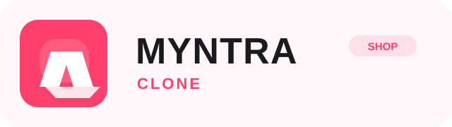
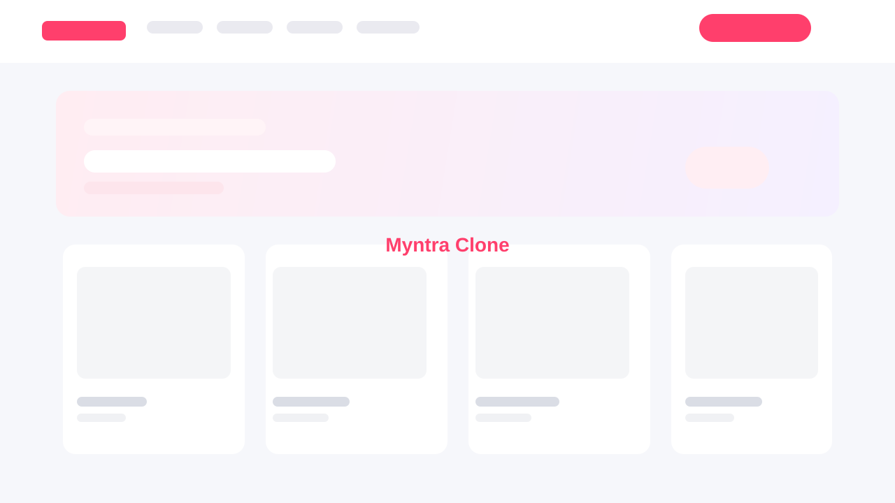

# Myntra Clone Frontend

  

  <strong>Fashion meets functionality.</strong> 
  A premium, Myntra-inspired storefront designed to mimic a real online shopping experience.

  <a href="https://mangeshpillew-alt.github.io/Myntra_clone/"><strong>🛍️ Open the Live Demo</strong></a>

## About the project

This project is a front-end e-commerce clone inspired by Myntra, built to recreate the look and flow of a premium fashion shopping platform using plain HTML, CSS, and JavaScript. It includes a product catalog, category browsing, wishlist behavior, cart interactions, and a checkout-style price summary—without relying on a backend stack.

The app is focused on a clean UI, polished layout, and real-world shopping interactions, making it a strong fit for portfolio showcases, design practice, and front-end learning.

**Live demo:** [Interact with the Myntra Clone](https://mangeshpillew-alt.github.io/Myntra_clone/)

### GitHub About / Repository Tagline

Myntra-inspired fashion storefront demo with responsive shopping, wishlist, and bag flows.

### Short project description

A fashion e-commerce front-end clone built with HTML, CSS, and JavaScript to simulate a premium online shopping experience with product filters, wishlist actions, and bag summary functionality.

### GitHub ready text

- GitHub Repository Tagline: Myntra-inspired fashion storefront demo with responsive shopping, wishlist, and bag flows.
- Portfolio / Resume Title: Myntra-Inspired E-commerce Frontend Clone | HTML, CSS, JavaScript
- Short Project Summary: Built a premium fashion e-commerce frontend clone featuring category browsing, product filters, wishlist actions, and a dynamic shopping bag experience.
- Very Short GitHub Description: Frontend ecommerce UI clone inspired by Myntra.
- Professional Summary: Designed and developed a Myntra-inspired fashion shopping interface with responsive UI, interactive filters, wishlist functionality, and checkout-style cart interactions.
- Portfolio Paragraph: This project is a Myntra-inspired e-commerce frontend clone built using HTML, CSS, and JavaScript. It recreates a premium fashion shopping experience with responsive product browsing, category-based filters, dynamic search, wishlist interactions, and a shopping bag with price summary calculations. The application focuses on clean UI/UX design, interactive front-end behavior, and realistic user flows, making it a strong example of frontend development and UI design for portfolio and learning purposes.

## Portfolio / LinkedIn Summary

Built a Myntra-inspired ecommerce frontend clone using HTML, CSS, and JavaScript, featuring a responsive storefront, product sorting and filters, wishlist management, shopping bag logic, and a polished checkout flow. This project highlights strong UI/UX design, client-side state management, and practical front-end development skills in a real-world shopping context.

## Demo GIF

## Screenshot

## Features

- Responsive Myntra-inspired homepage
- Category browsing for Men, Women, Footwear, Beauty, and more
- Product search and keyword filtering
- Sorting by price and discount
- Wishlist with localStorage persistence
- Add-to-bag flow with live item count
- Checkout-style pricing summary with totals and discounts
- Profile page and shopping journey UI
- Static front-end demo with no backend dependency

## Tech Stack

## Project Structure

- `myclone.html` — Main storefront page
- `bag.html` — Shopping bag and checkout summary page
- `profile.html` — User profile page
- `script.js` — Product filtering, search, sorting, and wishlist logic
- `bag.js` — Bag calculations and summary functionality
- `profile.js` — Profile page interactions
- `index.css` — Main storefront styling
- `checkout.css` — Bag and checkout styling
- `profile.css` — Profile styling
- `myntra.jpg` — Branding/logo asset
- `assets/preview.svg` — Project preview artwork
- `assets/myntra-clone-logo.svg` — Brand logo asset

## Demo Notes

This is a front-end demo project only. It does not include real payment processing, authentication, backend APIs, or database integration. It is intended for UI/UX demonstration, portfolio showcasing, and learning purposes.

## Project Goal

To recreate a realistic online shopping experience using front-end technologies, with a focus on polished user interaction, aesthetics, and responsive ecommerce design.

## License

This project is created for educational and portfolio use. Feel free to adapt and learn from it.
